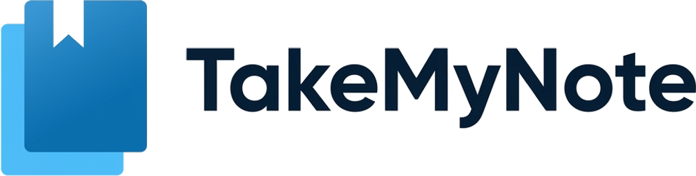
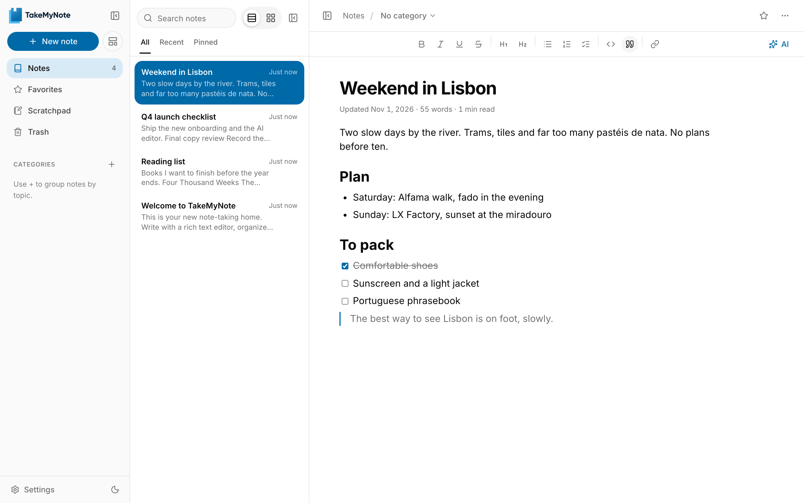
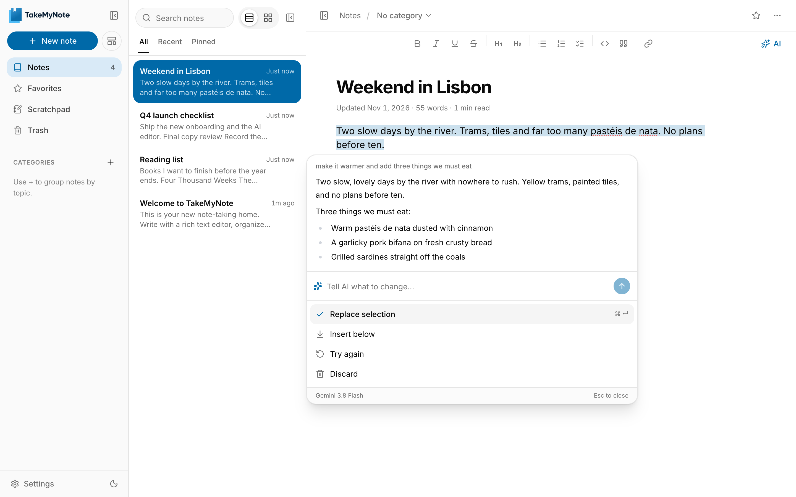
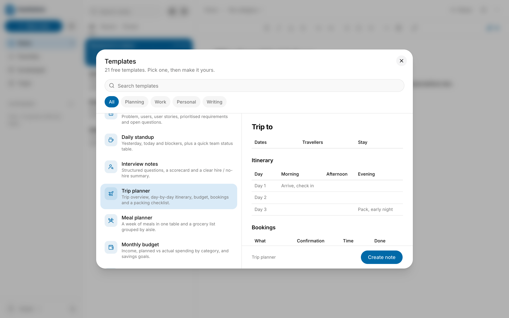

<div align="center">

<picture>
  <source media="(prefers-color-scheme: dark)" srcset=".github/assets/logo-dark.png">
  
</picture>

### Calm notes that stay in your browser.

A private, focused notebook with a rich editor, 21 free templates and AI that uses your own key.<br>
No account. No server. Your notes never leave your device.

[**Open the app**](https://www.takemynote.online/notes) · [Website](https://www.takemynote.online) · [Report a bug](https://github.com/sourav0809/takemynote/issues/new?template=bug_report.yml) · [Request a feature](https://github.com/sourav0809/takemynote/issues/new?template=feature_request.yml)

[](LICENSE)
[](https://github.com/sourav0809/takemynote/actions/workflows/ci.yml)
[](https://nextjs.org)
[](CONTRIBUTING.md)
[](https://github.com/sponsors/sourav0809)

<br>

<picture>
  <source media="(prefers-color-scheme: dark)" srcset=".github/assets/app-dark.png">
  
</picture>

</div>

## Why TakeMyNote

Most note apps want an account, a subscription and your data on their servers. TakeMyNote is the opposite: open it and start writing. Everything is saved in your browser, and nothing is uploaded unless you choose to use AI.

## Features

**Writing**
- Rich editor with headings, lists, task lists, quotes, tables, code blocks and images
- Type `/` for any block, or select text for formatting
- Word count and reading time, with your choice of writing area: left, centered or full width

**AI, with your own key** ([details below](#ai-with-your-own-key))
- Select a few lines and say what you want: *"add a few bullets and fix the grammar"*. Only that part changes.
- Quick actions: improve, fix spelling and grammar, shorter, longer, simplify, change tone, translate
- Write at the cursor, summarize a note, turn it into a checklist or keep writing
- Works with OpenAI, Google Gemini or Anthropic Claude

**Organize**
- Instant search across every note
- Favorites, pins, categories, trash and a scratchpad
- Two layouts (Classic three-column, or Library + Page) and collapsible sidebars

**Templates**
- 21 free templates: daily and weekly planners, meeting notes, trip planner, budget, habit tracker, book notes and more

**Yours to keep**
- Download any note as PDF, Markdown, text, HTML or JSON, or print it
- One-file backup of everything, and restore anywhere
- Light and dark mode, keyboard shortcuts for everything you do often

## AI with your own key



AI is optional. Add a key from OpenAI, Google or Anthropic during setup, in **Settings → AI**, or the first time you use an AI feature. Pick a model (only fast, inexpensive ones are offered) and, if you like, tell it how you write.

How your key is protected:

- **No middleman.** Requests go straight from your browser to the provider you chose, through the [Vercel AI SDK](https://ai-sdk.dev). TakeMyNote has no server that could see your key or your text.
- **Encrypted on your device.** The key is encrypted with AES-GCM using a WebCrypto key that can't be read back, even by the app's own code. Only the ciphertext is kept in local storage.
- **Never shared.** It's left out of backups and exports, never shown again after saving (only the last 4 characters), and can only be sent to the provider it belongs to.
- **Locked-down page.** A Content-Security-Policy only lets the app talk to itself and the three provider APIs.

Our own instructions to the model are fixed; yours (tone, language, style) are added on top and can't override them. Nothing changes in a note until you accept the result.

## Templates



## Keyboard shortcuts

| Action | Mac | Windows / Linux |
| --- | --- | --- |
| New note | `⌘` `⌥` `N` | `Ctrl` `Alt` `N` |
| Search notes | `⌘` `⌥` `F` | `Ctrl` `Alt` `F` |
| Add to favorites | `⌘` `⌥` `S` | `Ctrl` `Alt` `S` |
| Move to trash | `⌘` `⌥` `⌫` | `Ctrl` `Alt` `Backspace` |
| Light / dark | `⌘` `⌥` `T` | `Ctrl` `Alt` `T` |
| Collapse / expand sidebars | `⌘` `⌥` `\` | `Ctrl` `Alt` `\` |
| Ask AI (inside a note) | `⌘` `J` | `Ctrl` `J` |
| Insert a block | `/` | `/` |

## Run it locally

You need [Node.js](https://nodejs.org) 20.9 or newer.

```bash
git clone https://github.com/sourav0809/takemynote.git
cd takemynote
npm install
npm run dev
```

Open [http://localhost:3000](http://localhost:3000). No environment variables are needed to run the app.

| Script | What it does |
| --- | --- |
| `npm run dev` | Start the development server |
| `npm run build` | Production build |
| `npm start` | Serve the production build |
| `npm run lint` | ESLint |
| `npm run typecheck` | TypeScript, no output |

The scripts in `scripts/` that regenerate the brand images use OpenAI and Gemini keys from a `.env` file (see [`.env.example`](.env.example)). You only need them if you're changing the artwork.

### Deploy

It's a standard Next.js app with no backend or database, so it deploys anywhere Next.js runs. On [Vercel](https://vercel.com/new), import the repository and deploy; no settings are needed.

If you deploy to your own domain, set `NEXT_PUBLIC_SITE_URL` so canonical URLs, the sitemap and link previews point to it. `NEXT_PUBLIC_GOOGLE_SITE_VERIFICATION` and `NEXT_PUBLIC_BING_SITE_VERIFICATION` are optional, for Search Console and Bing Webmaster Tools.

## How it's built

| | |
| --- | --- |
| Framework | [Next.js 16](https://nextjs.org) (App Router), [React 19](https://react.dev), TypeScript |
| Editor | [BlockNote](https://www.blocknotejs.org) |
| AI | [Vercel AI SDK](https://ai-sdk.dev) with the OpenAI, Google and Anthropic providers |
| UI | [Tailwind CSS 4](https://tailwindcss.com), [shadcn/ui](https://ui.shadcn.com) on [Base UI](https://base-ui.com), [Lucide](https://lucide.dev) icons |
| Data | Browser `localStorage` through [TanStack Query](https://tanstack.com/query) |
| Export | [jsPDF](https://github.com/parallax/jsPDF) for PDFs |

```
app/
  (www)/            Landing page
  (app)/notes/      The app
components/         UI, grouped by area (editor, ai, settings, landing, …)
hooks/              React hooks (notes, preferences, AI streaming, …)
lib/
  ai/               Providers, prompts, writing agent, encrypted key vault
  data/             Local storage, migrations, preferences
  editor/           Note conversion (Markdown, HTML) and editor helpers
  export/           PDF export
  templates/        The template library
docs/               Design notes and plans
```

## Privacy

- Notes, categories and settings are stored in your browser's local storage. Clearing site data removes them, so make a backup from **Settings → Data management** first.
- There's no account, analytics or tracking.
- If you use AI, the text you choose is sent to the provider you picked, using your key. Nothing else ever leaves your device.

## Contributing

Contributions are welcome, from typo fixes to new templates and features. Read [CONTRIBUTING.md](CONTRIBUTING.md) to get started, and please follow the [Code of Conduct](CODE_OF_CONDUCT.md).

Found a security issue? Please report it privately as described in [SECURITY.md](SECURITY.md).

If TakeMyNote is useful to you, a ⭐ on GitHub helps other people find it.

## Support the project

TakeMyNote is free, open source and has no ads or paid plan. If it saves you time, you can help keep it going:

<a href="https://github.com/sponsors/sourav0809"></a>
<a href="https://buymeacoffee.com/sourav0809"></a>

## License

[MIT](LICENSE) © Sourav Pathak
